# STARQ Production Implementation Plan

> **Project**: STARQ Doorstep Car & Bike Washing Platform  
> **Strategy**: Convert existing Flutter frontend into a fully functional, production-ready app while preserving all existing UI and design assets.  
> **Safety Guard**: **READ-ONLY PHASE COMPLETE. NO SOURCE CODE MODIFIED. AWAITING USER APPROVAL.**  
> **Date**: September 20, 2026  

---

## 1. Phased Engineering Roadmap

```mermaid
flowchart LR
    P1["Phase 1:\nFoundations,\nDependencies & Models"] --> P2["Phase 2:\nAuth & Session\nManagement"]
    P2 --> P3["Phase 3:\nGarage & Vehicle\nCRUD"]
    P3 --> P4["Phase 4:\nService Catalog\n& Add-ons"]
    P4 --> P5["Phase 5:\nLocation & Slot\nAvailability"]
    P5 --> P6["Phase 6:\nAuthoritative Quote\n& Razorpay Payment"]
    P6 --> P7["Phase 7:\nConfirmation &\nLive GPS Tracking"]
    P7 --> P8["Phase 8:\nPre-Wash Audit &\nService Lifecycle"]
    P8 --> P9["Phase 9:\nReviews, Rewards\n& History"]
    P9 --> P10["Phase 10:\nNative Hardening\n& Operations Portal"]
```

---

## 2. Detailed Phase Breakdown

### Phase 1: Environment, Dependencies, Architecture Setup & Type Foundation
- **Goal**: Establish the application foundation, fix toolchain compatibility, and install production dependencies without breaking existing UI.
- **Tasks**:
  1. **Normalize SDK Constraint in `pubspec.yaml`**: Update `sdk: ^3.13.2` to `sdk: ">=3.11.0 <4.0.0"` so the project resolves cleanly against the installed Flutter 3.41.7 / Dart 3.11.5 environment.
  2. **Install Core Dependencies**:
     - Networking: `dio: ^5.7.0`
     - Secure Storage: `flutter_secure_storage: ^9.2.2`, `shared_preferences: ^2.3.2`
     - Payment: `razorpay_flutter: ^1.3.7`
     - Maps & GPS: `google_maps_flutter: ^2.10.0`, `geolocator: ^13.0.1`, `geocoding: ^3.0.0`
     - Formatting & Utils: `intl: ^0.19.0`, `cached_network_image: ^3.4.1`, `flutter_svg: ^2.0.10+1`
     - Environment: `flutter_dotenv: ^5.2.1`
  3. **Establish Clean Architecture Directory Structure**:
     - Create `lib/core/{config, network, storage, errors, utils, router}`.
     - Create `lib/features/{auth, vehicles, services, booking, payment, tracking, inspection, history, rewards}`.
  4. **Implement Data Models**:
     - `UserModel`, `VehicleModel`, `AddressModel`, `ServiceItemModel`, `AddOnModel`, `BookingQuoteModel`, `BookingModel`, `PaymentModel`, `PartnerModel`, `ReviewModel`, `RewardModel`.
  5. **Implement Network Client & Environment Config**:
     - `ApiClient` (Dio) with request/response logging and `AuthInterceptor`.
     - `.env.example` and `.env` support for `API_BASE_URL`, `RAZORPAY_KEY_ID`, `GOOGLE_MAPS_API_KEY`.
- **Exit Criteria**: `flutter pub get` passes with 0 errors; all models have unit-tested serialization/deserialization.

---

### Phase 2: Authentication & User Profile Management
- **Goal**: Replace mock `auth_service.dart` with real JWT authentication supporting Phone OTP and Email/Password.
- **Tasks**:
  1. Implement `AuthApi` and `AuthRepository`.
  2. Implement `AuthProvider` (ChangeNotifier) to manage `AuthState` (`unauthenticated`, `authenticating`, `authenticated`).
  3. Wire `SignInScreen` and `CreateAccountScreen` controllers to `AuthProvider`.
  4. Build OTP Verification bottom sheet / screen for phone number login (as per Figma specification).
  5. Integrate `FlutterSecureStorage` for access and refresh token lifecycle.
  6. Update `GoRouter` in `app_router.dart` with an `authGuard` redirecting unauthenticated users to `/sign-in` and authenticated users to `/home`.
  7. Connect `ProfileScreen` to display the real authenticated user's name, email, and phone number, with working Logout functionality.
- **Exit Criteria**: User can sign up, sign in with real credentials, maintain session across app restarts, and safely log out.

---

### Phase 3: Vehicle Management (My Garage)
- **Goal**: Make `MyGarageScreen` 100% dynamic and provide full Add/Edit/Delete vehicle capabilities.
- **Tasks**:
  1. Implement `VehicleApi` and `VehicleRepository` (`GET`, `POST`, `PUT`, `DELETE /api/v1/vehicles`).
  2. Implement `GarageProvider` to manage the list of customer vehicles and currently selected active vehicle.
  3. Connect `MyGarageScreen` to render real vehicles from `GarageProvider`.
  4. Create **`AddVehicleScreen`** (Brand, Model, Variant, Category [Hatchback, Sedan, SUV, Bike], Registration Plate, Color).
  5. Implement Edit & Delete actions with confirmation modals.
  6. Update `HomeDashboardScreen` vehicle card to automatically reflect the user's primary/active vehicle.
- **Exit Criteria**: Customer can add their car/bike, view it in My Garage, select it for a wash, and edit/delete it.

---

### Phase 4: Service Catalog, Add-Ons & Pricing Engine
- **Goal**: Connect service exploration to the backend catalog, enable dynamic vehicle-tier pricing, and add optional add-ons.
- **Tasks**:
  1. Implement `ServiceApi` and `ServiceRepository` (`GET /api/v1/services?vehicle_type={type}`).
  2. Refactor `ServiceSelectionScreen` to dynamically load services and prices from the server.
  3. Refactor the six duplicate service screens into a single dynamic **`ServiceDetailScreen`** driven by `service_id`.
  4. Build the **Add-On Selection Component** inside `ServiceDetailScreen` (Tyre Polish, Interior Fragrance, Engine Cleaning) with checkboxes and live subtotal calculation.
  5. Preserve the complete selected `VehicleModel`, `ServiceItemModel`, and list of `AddOnModel`s in `BookingFlowProvider`.
- **Exit Criteria**: Service listings, images, and prices load dynamically from backend; selecting add-ons updates the booking wizard state.

---

### Phase 5: Location, Address Book & Slot Availability
- **Goal**: Enable address selection with GPS and dynamic slot checking based on partner capacity.
- **Tasks**:
  1. Implement `AddressApi` and `AddressRepository` (`GET`, `POST /api/v1/addresses`).
  2. Connect `ChooseLocationScreen` to display user's saved addresses.
  3. Implement "Use Current Location" using `geolocator` and reverse geocoding to resolve address details.
  4. Create **`AddAddressModal`** (House/Flat, Street, Area, Landmark, Pincode).
  5. Integrate Pincode Serviceability Check: Alert customer if their location is outside STARQ operating zones.
  6. Connect `SelectDateTimeScreen` to `GET /api/v1/bookings/available-slots?date={date}&pincode={pincode}`.
  7. Disable fully booked time slots and slots within the 2-hour immediate buffer window.
- **Exit Criteria**: User can select/add a verified location and pick an available slot validated by the backend.

---

### Phase 6: Authoritative Booking Summary & Razorpay Secure Checkout
- **Goal**: Enforce server-side price calculation and implement native Razorpay payment.
- **Tasks**:
  1. Refactor `BookingSummaryScreen` to invoke `POST /api/v1/bookings/quote`:
     - Send `{vehicle_id, service_id, add_on_ids[], address_id, slot_id, coupon_code}`.
     - Display authoritative breakdown received from server: Base Price + Add-ons + Convenience Fee + GST - Discount = Total.
  2. Add coupon code input with `POST /api/v1/coupons/validate`.
  3. Connect "Continue to Payment" to `POST /api/v1/payments/create-order`:
     - Backend creates Razorpay order and returns `razorpay_order_id` and public `key_id`.
  4. Integrate `Razorpay` SDK in `PaymentScreen`:
     - Open Razorpay native sheet with order options.
     - Handle `PAYMENT_SUCCESS`: Send `{razorpay_order_id, razorpay_payment_id, razorpay_signature}` to `POST /api/v1/payments/verify`.
     - Handle `PAYMENT_ERROR`: Show user-friendly error and allow retry.
  5. Only navigate forward to confirmation screen upon verified HTTP 200 from backend verification.
- **Exit Criteria**: End-to-end payment completes via Razorpay test mode; backend verifies HMAC signature and confirms booking in PostgreSQL.

---

### Phase 7: Order Confirmation, Partner Assignment & Live GPS Tracking
- **Goal**: Replace 12-line placeholder screen with production confirmation and build live partner tracking.
- **Tasks**:
  1. Redesign **`OrderConfirmedScreen`**:
     - Display success animation, Booking ID (`#STQ-XXXX`), vehicle, date/time, address.
     - Partner status badge: "Assigning nearest certified expert...".
     - Primary CTA: "Track Service Partner" (navigates to `/tracking/:bookingId`).
     - Secondary CTA: "Back to Home".
  2. Build **`LiveTrackingScreen`**:
     - Embedded `GoogleMap` showing customer marker, partner marker, and polyline route.
     - Real-time partner location updates via WebSocket / Supabase Realtime channel.
     - Live ETA badge (e.g. "Arriving in 14 mins").
     - Partner Card: Photo, Name, Rating, Masked Phone Call button.
     - Status Lifecycle Stepper: `Confirmed → Partner Assigned → On The Way → Arrived`.
- **Exit Criteria**: Confirmed booking displays on map with real-time simulated or live partner movement and status transitions.

---

### Phase 8: Pre-Wash Vehicle Condition Inspection & Service Progress
- **Goal**: Implement legally auditable pre-existing damage sign-off and in-progress wash tracking.
- **Tasks**:
  1. Build **`VehicleConditionDialog`**:
     - Displays partner's 4–6 pre-wash photos (front, rear, sides, closeups of scratches/dents).
     - Customer checks: *"I acknowledge the recorded pre-existing condition of my vehicle."*
     - Customer taps "Approve & Start Wash" (`POST /api/v1/inspections/:id/consent`).
  2. Build **`ServiceInProgressView`**:
     - Visual stage progress indicator (Exterior foam rinse → Detailing → Interior vacuum → Final shine).
     - Estimated completion time banner.
  3. Transition to Completion View upon partner marking job done.
- **Exit Criteria**: Audit record saved in PostgreSQL with customer timestamp; app transitions smoothly through all service stages.

---

### Phase 9: Ratings, Reviews, Starq Points & Booking History
- **Goal**: Complete post-service customer loop with feedback, loyalty points, and history.
- **Tasks**:
  1. Build **`RatingReviewModal`**:
     - 1 to 5 star interactive rating.
     - Multi-select feedback chips ("Super Clean", "Punctual", "Careful", "Great Shine").
     - Written comment box and submission to `POST /api/v1/reviews`.
  2. Implement **`BookingHistoryScreen`** (`/bookings`):
     - Segmented tabs: "Active" and "Past".
     - Booking cards displaying vehicle, date, price, status badge.
     - "Book Again" button pre-populating wizard with the same vehicle and service.
  3. Implement **`RewardsScreen`** (`/rewards`):
     - Total Starq Points balance card.
     - Ledger of points earned and redeemed.
     - Referral bonus card.
  4. Standardize `AppBottomNav` across all primary screens with working routes:
     - Tab 0: Home (`/home`)
     - Tab 1: Bookings (`/bookings`)
     - Tab 2: Rewards (`/rewards`)
     - Tab 3: Profile (`/profile`)
- **Exit Criteria**: Customer can review past washes, rate partners, see accumulated points, and rebook in 1 tap.

---

### Phase 10: Native Hardening, Security Audit & Admin Operations Desk
- **Goal**: Prepare production release builds and connect operations desk.
- **Tasks**:
  1. **Android Configuration**:
     - Update package name to `com.starq.customer`.
     - Add `INTERNET`, `ACCESS_FINE_LOCATION`, `ACCESS_COARSE_LOCATION`, `POST_NOTIFICATIONS` to `AndroidManifest.xml`.
  2. **iOS Configuration**:
     - Set bundle ID to `com.starq.customer`.
     - Add `NSLocationWhenInUseUsageDescription`, `NSCameraUsageDescription`, `NSPhotoLibraryUsageDescription` to `Info.plist`.
  3. **Automated Testing**:
     - Unit tests for all repositories, models, and calculation verification.
     - Widget tests for booking wizard screens.
  4. **Backend Operations Portal Deployment**:
     - Deploy admin dashboard for partner onboarding, manual dispatch overrides, and refund management.
- **Exit Criteria**: Release APK/AAB and iOS archive build successfully without warnings; end-to-end user journey passes automated test suites.

---

## 3. Recommended Immediate Next Step (Step 1)

### Phase 1: Environment, Dependencies, Architecture Setup & Type Foundation

**Objective**: Fix toolchain compatibility, install production packages, establish clean feature directories, implement all domain data models, and set up the network client. Zero existing UI will be removed.

### Exact Files to be Created or Modified in Next Step:

#### [MODIFY] Existing Files:
1. `pubspec.yaml`
   - Adjust `sdk: ^3.13.2` to `sdk: ">=3.11.0 <4.0.0"`.
   - Add production dependencies (`dio`, `flutter_secure_storage`, `shared_preferences`, `razorpay_flutter`, `google_maps_flutter`, `geolocator`, `intl`, `cached_network_image`, `flutter_dotenv`).
2. `lib/main.dart`
   - Wrap app in `MultiProvider` with initial state containers.
   - Initialize `dotenv` and dependency injection before `runApp()`.
3. `android/app/src/main/AndroidManifest.xml`
   - Add `INTERNET`, `ACCESS_FINE_LOCATION`, and `ACCESS_COARSE_LOCATION` permissions.

#### [NEW] Architecture & Model Files to be Created:
4. `lib/core/config/env_config.dart` — Typed environment variable provider.
5. `lib/core/network/api_client.dart` — Dio HTTP client with interceptors and timeout handling.
6. `lib/core/network/api_endpoints.dart` — Canonical REST API endpoint paths.
7. `lib/core/storage/secure_storage_service.dart` — Keychain / Keystore token storage.
8. `lib/core/utils/formatters.dart` — Indian Rupee (`₹`), date, and time formatting helpers.
9. `lib/features/auth/domain/user.dart` — User entity and role definitions.
10. `lib/features/vehicles/domain/vehicle.dart` — Vehicle entity with category enum.
11. `lib/features/services/domain/service_item.dart` — Service catalog item model.
12. `lib/features/services/domain/add_on.dart` — Add-on option model.
13. `lib/features/booking/domain/booking_quote.dart` — Server quote breakdown model.
14. `lib/features/booking/domain/booking_model.dart` — Active and past booking model.
15. `lib/features/payment/domain/payment_intent.dart` — Razorpay order payload model.
16. `.env.example` — Environment template for local development.

---
*End of Implementation Plan.*
