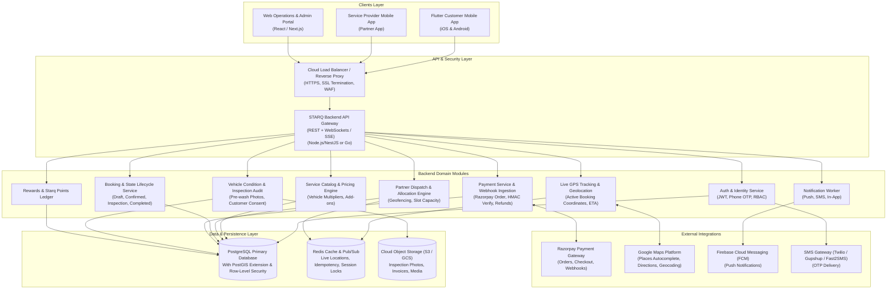
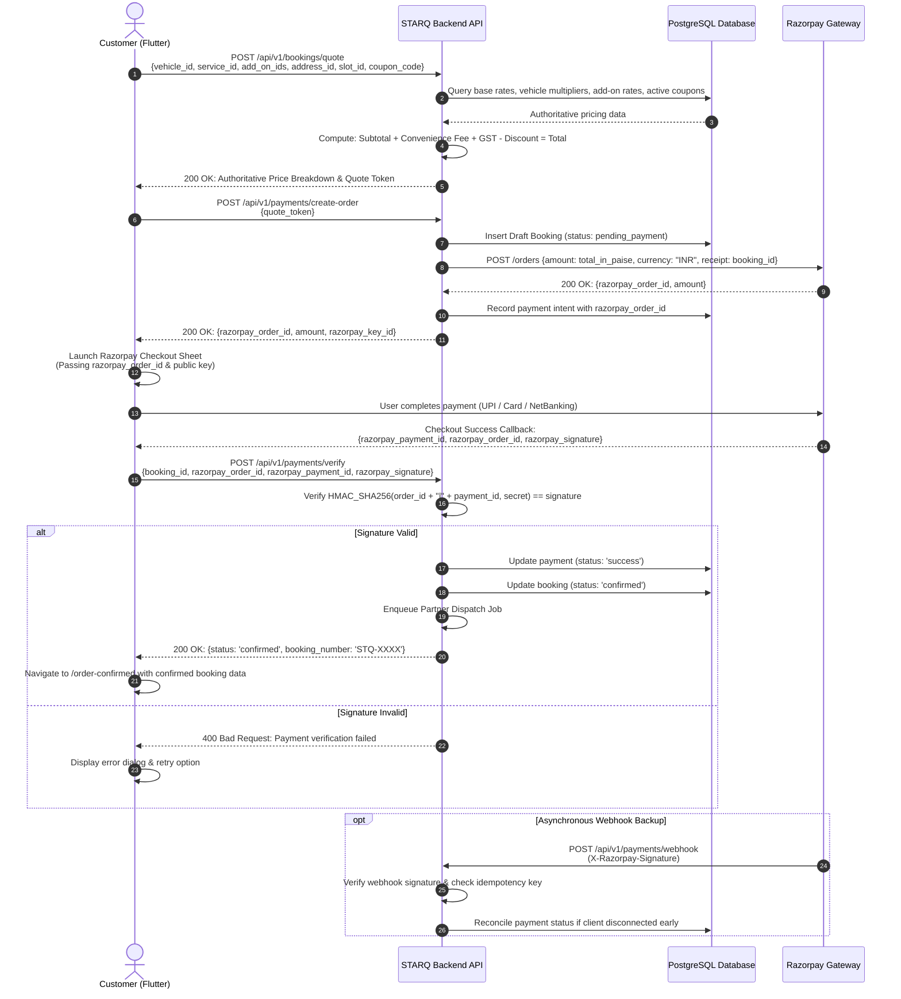

# STARQ Recommended Production Architecture

> **System**: STARQ Doorstep Car & Bike Washing Platform  
> **Target Production Topology**: Flutter Customer App ↔ STARQ Backend API ↔ PostgreSQL  
> **External Integrations**: Razorpay, Google Maps / Places, Cloud Storage, Firebase Cloud Messaging, SMS Gateway  
> **Date**: September 20, 2026  

---

## 1. High-Level Architecture Overview

The target STARQ system is designed around a **server-authoritative, highly secure, modular architecture** where all pricing, dispatching, state transitions, and payment authorizations are executed on the backend. The Flutter customer app acts as a reactive, presentation-focused client while retaining its modern automotive UI/UX.



---

## 2. Flutter Customer App Architecture

To transform the prototype into a production-grade application without discarding the existing UI, the frontend will adopt a **Clean Architecture with Feature-First Modular Structure**.

### 2.1 Directory Layout

```
lib/
├── app.dart                                # Root MaterialApp.router with global providers
├── main.dart                               # Entry point, environment bootstrap, error zones
├── core/                                   # Application-wide singletons and primitives
│   ├── config/
│   │   ├── env_config.dart                 # Base URLs, Razorpay Key, Google Maps Key
│   │   └── app_constants.dart              # Global timeouts, formatters, defaults
│   ├── network/
│   │   ├── api_client.dart                 # Dio instance with interceptors
│   │   ├── api_endpoints.dart              # URL constants (/api/v1/...)
│   │   ├── api_response.dart               # Generic ApiResponse<T> wrapper
│   │   └── error_handler.dart              # AppException mapping (401, 403, 404, 500)
│   ├── storage/
│   │   ├── secure_storage_service.dart     # JWT tokens, refresh tokens via flutter_secure_storage
│   │   └── local_cache_service.dart        # User prefs, theme, cache via shared_preferences
│   ├── theme/                              # Existing AppColors, AppTextStyles, ThemeData
│   │   ├── app_colors.dart
│   │   ├── app_text_styles.dart
│   │   └── app_theme.dart
│   ├── router/
│   │   ├── app_router.dart                 # GoRouter with Auth Guard & dynamic params
│   │   └── route_names.dart                # Type-safe route string constants
│   └── utils/
│       ├── formatters.dart                 # Currency (₹), Date, Time, Phone
│       ├── validators.dart                 # Email, Mobile, Reg Plate validators
│       └── location_helper.dart            # Geolocator permissions & coordinates
│
├── features/                               # Feature-First Modules
│   ├── auth/                               # Login, Signup, OTP, Session
│   │   ├── data/ {auth_api.dart, auth_repository.dart, user_dto.dart}
│   │   ├── domain/ {user.dart, auth_state.dart}
│   │   └── presentation/ {controllers/, screens/, widgets/}
│   ├── vehicles/                           # My Garage, Add Vehicle, Edit Vehicle
│   │   ├── data/ {vehicle_api.dart, vehicle_repository.dart, vehicle_dto.dart}
│   │   ├── domain/ {vehicle.dart, vehicle_type.dart}
│   │   └── presentation/ {controllers/, screens/, widgets/}
│   ├── services/                           # Services Catalog, Add-ons, Details
│   │   ├── data/ {service_api.dart, service_repository.dart, service_dto.dart}
│   │   ├── domain/ {service_item.dart, add_on.dart}
│   │   └── presentation/ {controllers/, screens/, widgets/}
│   ├── booking/                            # Scheduling, Location, Quote, Summary
│   │   ├── data/ {booking_api.dart, booking_repository.dart, booking_dto.dart}
│   │   ├── domain/ {booking_quote.dart, booking_draft.dart, time_slot.dart}
│   │   └── presentation/ {controllers/, screens/, widgets/}
│   ├── payment/                            # Razorpay Checkout & Verification
│   │   ├── data/ {payment_api.dart, payment_repository.dart}
│   │   ├── domain/ {payment_result.dart, razorpay_order.dart}
│   │   └── presentation/ {controllers/, screens/, widgets/}
│   ├── tracking/                           # Live Partner GPS Map & Status Stepper
│   │   ├── data/ {tracking_api.dart, tracking_socket.dart}
│   │   ├── domain/ {partner_location.dart, booking_status_update.dart}
│   │   └── presentation/ {controllers/, screens/, widgets/}
│   ├── inspection/                         # Pre-Wash Damage Audit & Consent Modal
│   │   ├── data/ {inspection_api.dart}
│   │   ├── domain/ {vehicle_inspection.dart, damage_point.dart}
│   │   └── presentation/ {controllers/, widgets/}
│   ├── history/                            # Active & Past Bookings List
│   │   ├── data/ {history_api.dart}
│   │   ├── domain/ {booking_history_item.dart}
│   │   └── presentation/ {controllers/, screens/, widgets/}
│   ├── profile/                            # Customer Profile & Settings
│   └── rewards/                            # Starq Points & Referral Ledger
│
└── shared/                                 # Reusable widgets (Existing + enhanced)
    ├── widgets/
    │   ├── app_button.dart                 # From existing custom_button.dart
    │   ├── hover_card.dart                 # From existing custom_button.dart
    │   ├── custom_text_field.dart          # Enhanced with validation & masks
    │   ├── starq_logo.dart                 # Existing logo component
    │   ├── app_bottom_nav.dart             # Standardized 4-tab bar
    │   ├── loading_indicator.dart          # Shimmer / animated spinner
    │   └── error_view.dart                 # Generic retryable error card
    └── dialogs/
        ├── confirmation_dialog.dart
        └── damage_consent_dialog.dart
```

### 2.2 State Management Strategy
- Standardize on **`Provider` / `ChangeNotifier`** (already in `pubspec.yaml`):
  - `AuthProvider`: Holds session state, authenticated user entity, JWT tokens, login/logout methods.
  - `GarageProvider`: Holds list of user vehicles, currently selected vehicle, add/edit/delete actions.
  - `BookingFlowProvider`: Orchestrates the active wizard flow across screens (`selectedVehicle` → `selectedService` → `selectedAddOns` → `selectedAddress` → `selectedSlot` → `serverQuote`).
  - `TrackingProvider`: Holds active booking live status, partner GPS coordinates, and WebSocket connection.
- Keep UI widgets reactive and clean by consuming providers via `context.watch<T>()` and `context.read<T>()`.

---

## 3. Authoritative Pricing & Payment Architecture

### 3.1 Strict Security Principles
1. **Zero Client Authority**: The Flutter client never calculates prices, discounts, convenience fees, or taxes for financial transactions. It only displays server-calculated figures.
2. **Server-Generated Razorpay Orders**: The backend calls Razorpay's `/orders` API using its private `RAZORPAY_KEY_SECRET`. The resulting `razorpay_order_id` is sent to the client.
3. **Frontend Secret Protection**: The Flutter app only ever receives `RAZORPAY_KEY_ID` (public key). The `RAZORPAY_KEY_SECRET` never enters the Flutter codebase, builds, or network responses.
4. **Cryptographic Verification**: On client payment completion, the backend independently computes `HMAC_SHA256(order_id + "|" + payment_id, secret)` and compares it to `razorpay_signature`.
5. **Webhook Reconciliation & Idempotency**: The backend verifies all Razorpay webhook payloads and records `event_id` in an idempotency table to safely ignore duplicate events.

### 3.2 Payment Sequence Diagram



---

## 4. PostgreSQL Database Schema (Production DDL)

Below is the complete, relational PostgreSQL schema with constraints, indexes, and audit logs.

```sql
-- Enable necessary extensions
CREATE EXTENSION IF NOT EXISTS "pgcrypto";
CREATE EXTENSION IF NOT EXISTS "uuid-ossp";

-- ============================================================
-- ENUMS
-- ============================================================
CREATE TYPE user_role AS ENUM ('customer', 'service_partner', 'admin', 'operator');
CREATE TYPE vehicle_category AS ENUM ('hatchback', 'sedan', 'suv', 'muv', 'luxury', 'bike');
CREATE TYPE booking_status AS ENUM (
    'pending_payment',
    'confirmed',
    'partner_assigned',
    'provider_on_the_way',
    'arrived',
    'inspection_submitted',
    'inspection_approved',
    'service_started',
    'service_completed',
    'cancelled_by_customer',
    'cancelled_by_admin',
    'failed'
);
CREATE TYPE payment_status AS ENUM ('pending', 'processing', 'success', 'failed', 'refunded');

-- ============================================================
-- 1. USERS & PROFILES
-- ============================================================
CREATE TABLE users (
    id UUID PRIMARY KEY DEFAULT gen_random_uuid(),
    phone VARCHAR(15) UNIQUE NOT NULL,
    email VARCHAR(255) UNIQUE,
    full_name VARCHAR(100) NOT NULL,
    role user_role NOT NULL DEFAULT 'customer',
    avatar_url TEXT,
    is_active BOOLEAN NOT NULL DEFAULT TRUE,
    created_at TIMESTAMPTZ NOT NULL DEFAULT NOW(),
    updated_at TIMESTAMPTZ NOT NULL DEFAULT NOW()
);

-- ============================================================
-- 2. CUSTOMER VEHICLES
-- ============================================================
CREATE TABLE vehicles (
    id UUID PRIMARY KEY DEFAULT gen_random_uuid(),
    user_id UUID NOT NULL REFERENCES users(id) ON DELETE CASCADE,
    category vehicle_category NOT NULL,
    brand VARCHAR(50) NOT NULL,
    model VARCHAR(50) NOT NULL,
    variant VARCHAR(50),
    registration_number VARCHAR(20) NOT NULL,
    color VARCHAR(30),
    fuel_type VARCHAR(20),
    is_primary BOOLEAN NOT NULL DEFAULT FALSE,
    created_at TIMESTAMPTZ NOT NULL DEFAULT NOW(),
    updated_at TIMESTAMPTZ NOT NULL DEFAULT NOW(),
    UNIQUE (user_id, registration_number)
);

-- ============================================================
-- 3. CUSTOMER ADDRESSES
-- ============================================================
CREATE TABLE addresses (
    id UUID PRIMARY KEY DEFAULT gen_random_uuid(),
    user_id UUID NOT NULL REFERENCES users(id) ON DELETE CASCADE,
    label VARCHAR(30) NOT NULL DEFAULT 'Home', -- Home, Work, Other
    address_line TEXT NOT NULL,
    landmark VARCHAR(100),
    city VARCHAR(50) NOT NULL DEFAULT 'Noida',
    state VARCHAR(50) NOT NULL DEFAULT 'Uttar Pradesh',
    pincode VARCHAR(10) NOT NULL,
    latitude NUMERIC(10, 7) NOT NULL,
    longitude NUMERIC(10, 7) NOT NULL,
    is_default BOOLEAN NOT NULL DEFAULT FALSE,
    created_at TIMESTAMPTZ NOT NULL DEFAULT NOW()
);

-- ============================================================
-- 4. SERVICE AREAS & GEOFENCING
-- ============================================================
CREATE TABLE service_areas (
    id UUID PRIMARY KEY DEFAULT gen_random_uuid(),
    name VARCHAR(100) NOT NULL,
    pincode VARCHAR(10) NOT NULL,
    city VARCHAR(50) NOT NULL,
    is_active BOOLEAN NOT NULL DEFAULT TRUE,
    created_at TIMESTAMPTZ NOT NULL DEFAULT NOW()
);

-- ============================================================
-- 5. SERVICE CATALOG & PRICING ENGINE
-- ============================================================
CREATE TABLE services (
    id UUID PRIMARY KEY DEFAULT gen_random_uuid(),
    slug VARCHAR(50) UNIQUE NOT NULL,
    name VARCHAR(100) NOT NULL,
    target_vehicle_type VARCHAR(10) NOT NULL, -- 'car' or 'bike'
    description TEXT NOT NULL,
    base_price NUMERIC(10, 2) NOT NULL,
    duration_minutes INT NOT NULL,
    image_asset_path TEXT NOT NULL,
    is_active BOOLEAN NOT NULL DEFAULT TRUE,
    sort_order INT NOT NULL DEFAULT 0,
    created_at TIMESTAMPTZ NOT NULL DEFAULT NOW()
);

CREATE TABLE service_features (
    id UUID PRIMARY KEY DEFAULT gen_random_uuid(),
    service_id UUID NOT NULL REFERENCES services(id) ON DELETE CASCADE,
    section_name VARCHAR(50) NOT NULL DEFAULT '', -- Exterior, Interior, Finishing
    feature_text VARCHAR(150) NOT NULL,
    sort_order INT NOT NULL DEFAULT 0
);

CREATE TABLE service_tier_multipliers (
    id UUID PRIMARY KEY DEFAULT gen_random_uuid(),
    service_id UUID NOT NULL REFERENCES services(id) ON DELETE CASCADE,
    category vehicle_category NOT NULL,
    price_multiplier NUMERIC(3, 2) NOT NULL DEFAULT 1.00,
    UNIQUE (service_id, category)
);

CREATE TABLE add_ons (
    id UUID PRIMARY KEY DEFAULT gen_random_uuid(),
    name VARCHAR(100) NOT NULL,
    description TEXT,
    price NUMERIC(10, 2) NOT NULL,
    duration_minutes INT NOT NULL DEFAULT 15,
    applicable_vehicle_type VARCHAR(10) NOT NULL, -- 'car', 'bike', 'both'
    is_active BOOLEAN NOT NULL DEFAULT TRUE
);

-- ============================================================
-- 6. SERVICE PARTNERS (WORKFORCE)
-- ============================================================
CREATE TABLE service_partners (
    id UUID PRIMARY KEY REFERENCES users(id) ON DELETE CASCADE,
    assigned_service_area_id UUID REFERENCES service_areas(id),
    current_lat NUMERIC(10, 7),
    current_lng NUMERIC(10, 7),
    last_location_updated_at TIMESTAMPTZ,
    is_online BOOLEAN NOT NULL DEFAULT FALSE,
    is_available BOOLEAN NOT NULL DEFAULT TRUE,
    rating NUMERIC(2, 1) NOT NULL DEFAULT 5.0,
    total_completed_jobs INT NOT NULL DEFAULT 0,
    created_at TIMESTAMPTZ NOT NULL DEFAULT NOW()
);

-- ============================================================
-- 7. BOOKINGS
-- ============================================================
CREATE TABLE bookings (
    id UUID PRIMARY KEY DEFAULT gen_random_uuid(),
    booking_number VARCHAR(20) UNIQUE NOT NULL, -- e.g. STQ-2026-98124
    customer_id UUID NOT NULL REFERENCES users(id),
    partner_id UUID REFERENCES service_partners(id),
    vehicle_id UUID NOT NULL REFERENCES vehicles(id),
    service_id UUID NOT NULL REFERENCES services(id),
    address_id UUID NOT NULL REFERENCES addresses(id),
    
    scheduled_date DATE NOT NULL,
    scheduled_time_slot VARCHAR(30) NOT NULL, -- e.g. "10:00 AM - 11:00 AM"
    
    -- Financial Breakdown (All Server-Calculated)
    base_service_amount NUMERIC(10, 2) NOT NULL,
    add_ons_amount NUMERIC(10, 2) NOT NULL DEFAULT 0.00,
    convenience_fee NUMERIC(10, 2) NOT NULL DEFAULT 30.00,
    tax_amount NUMERIC(10, 2) NOT NULL DEFAULT 0.00, -- GST (18%)
    discount_amount NUMERIC(10, 2) NOT NULL DEFAULT 0.00,
    final_total_amount NUMERIC(10, 2) NOT NULL,
    points_awarded INT NOT NULL DEFAULT 0,
    
    status booking_status NOT NULL DEFAULT 'pending_payment',
    cancellation_reason TEXT,
    created_at TIMESTAMPTZ NOT NULL DEFAULT NOW(),
    updated_at TIMESTAMPTZ NOT NULL DEFAULT NOW()
);

CREATE TABLE booking_selected_add_ons (
    id UUID PRIMARY KEY DEFAULT gen_random_uuid(),
    booking_id UUID NOT NULL REFERENCES bookings(id) ON DELETE CASCADE,
    add_on_id UUID NOT NULL REFERENCES add_ons(id),
    price_at_booking NUMERIC(10, 2) NOT NULL
);

CREATE TABLE booking_status_history (
    id UUID PRIMARY KEY DEFAULT gen_random_uuid(),
    booking_id UUID NOT NULL REFERENCES bookings(id) ON DELETE CASCADE,
    from_status booking_status,
    to_status booking_status NOT NULL,
    changed_by_user_id UUID REFERENCES users(id),
    notes TEXT,
    created_at TIMESTAMPTZ NOT NULL DEFAULT NOW()
);

-- ============================================================
-- 8. AUDITABLE VEHICLE INSPECTION & DAMAGE SIGN-OFF
-- ============================================================
CREATE TABLE vehicle_condition_inspections (
    id UUID PRIMARY KEY DEFAULT gen_random_uuid(),
    booking_id UUID NOT NULL UNIQUE REFERENCES bookings(id) ON DELETE CASCADE,
    partner_id UUID NOT NULL REFERENCES service_partners(id),
    pre_existing_damages_found BOOLEAN NOT NULL DEFAULT FALSE,
    inspection_notes TEXT,
    photo_urls JSONB NOT NULL DEFAULT '[]', -- Array of uploaded image URLs in Cloud Storage
    customer_consent_given BOOLEAN NOT NULL DEFAULT FALSE,
    customer_consented_at TIMESTAMPTZ,
    customer_ip_address VARCHAR(45),
    created_at TIMESTAMPTZ NOT NULL DEFAULT NOW()
);

-- ============================================================
-- 9. PAYMENTS & IDEMPOTENT WEBHOOKS
-- ============================================================
CREATE TABLE payments (
    id UUID PRIMARY KEY DEFAULT gen_random_uuid(),
    booking_id UUID NOT NULL REFERENCES bookings(id),
    razorpay_order_id VARCHAR(50) UNIQUE NOT NULL,
    razorpay_payment_id VARCHAR(50) UNIQUE,
    razorpay_signature VARCHAR(100),
    amount_in_rupees NUMERIC(10, 2) NOT NULL,
    currency VARCHAR(5) NOT NULL DEFAULT 'INR',
    method VARCHAR(30), -- UPI, CARD, NETBANKING
    status payment_status NOT NULL DEFAULT 'pending',
    created_at TIMESTAMPTZ NOT NULL DEFAULT NOW(),
    updated_at TIMESTAMPTZ NOT NULL DEFAULT NOW()
);

CREATE TABLE payment_webhook_events (
    id UUID PRIMARY KEY DEFAULT gen_random_uuid(),
    event_id VARCHAR(100) UNIQUE NOT NULL, -- Razorpay event ID for deduplication
    event_type VARCHAR(50) NOT NULL,
    payload JSONB NOT NULL,
    is_processed BOOLEAN NOT NULL DEFAULT FALSE,
    processed_at TIMESTAMPTZ,
    created_at TIMESTAMPTZ NOT NULL DEFAULT NOW()
);

-- ============================================================
-- 10. REVIEWS & RATINGS
-- ============================================================
CREATE TABLE reviews (
    id UUID PRIMARY KEY DEFAULT gen_random_uuid(),
    booking_id UUID NOT NULL UNIQUE REFERENCES bookings(id),
    customer_id UUID NOT NULL REFERENCES users(id),
    partner_id UUID NOT NULL REFERENCES service_partners(id),
    rating INT NOT NULL CHECK (rating >= 1 AND rating <= 5),
    tags TEXT[], -- e.g. {"Punctual", "Super Clean", "Careful"}
    comment TEXT,
    created_at TIMESTAMPTZ NOT NULL DEFAULT NOW()
);

-- ============================================================
-- 11. STARQ POINTS & REWARDS LEDGER
-- ============================================================
CREATE TABLE rewards_ledger (
    id UUID PRIMARY KEY DEFAULT gen_random_uuid(),
    user_id UUID NOT NULL REFERENCES users(id) ON DELETE CASCADE,
    booking_id UUID REFERENCES bookings(id),
    points_delta INT NOT NULL, -- Positive for earned, negative for redeemed
    balance_after INT NOT NULL,
    description VARCHAR(255) NOT NULL,
    created_at TIMESTAMPTZ NOT NULL DEFAULT NOW()
);

-- ============================================================
-- INDEXES FOR MAXIMUM QUERY PERFORMANCE
-- ============================================================
CREATE INDEX idx_bookings_customer_id ON bookings(customer_id);
CREATE INDEX idx_bookings_partner_id ON bookings(partner_id);
CREATE INDEX idx_bookings_status ON bookings(status);
CREATE INDEX idx_bookings_scheduled_date ON bookings(scheduled_date);
CREATE INDEX idx_payments_order_id ON payments(razorpay_order_id);
CREATE INDEX idx_vehicles_user_id ON vehicles(user_id);
CREATE INDEX idx_addresses_user_id ON addresses(user_id);
```

---

## 5. Partner Assignment & Dispatching Engine

In compliance with the mandatory requirement: **"Customer does NOT select the service partner. Backend/admin assigns an available partner."**

### 5.1 Auto-Dispatch Logic
1. **Trigger**: Payment verification triggers `BookingDispatchWorker`.
2. **Eligibility Filtering**:
   - Filter partners where `is_online = true` and `is_available = true`.
   - Filter partners whose registered `service_area_id` encompasses the booking address pincode or whose current coordinates are within a **5 km radius**.
   - Filter partners qualified for the vehicle type (Car Wash certification vs Bike Wash).
3. **Scoring Function**:
   $$\text{Score} = (w_1 \times \text{Distance}) + (w_2 \times \text{Rating}) - (w_3 \times \text{JobsToday})$$
4. **Offer Window**: The highest-scoring partner receives an in-app assignment offer with a **60-second acceptance countdown timer**.
5. **Fallback & Escalation**: If the partner declines or times out, the system cascades to the next best partner. If no partners accept within 5 minutes, the booking is flagged in the **Admin Operations Portal** for manual dispatch.

---

## 6. Live Partner GPS Tracking Architecture

In compliance with: **"GPS tracking should only operate for an active booking."**

1. **Activation Trigger**: Tracking channel opens **only** when booking status transitions to `provider_on_the_way` or `arrived`.
2. **Channel Scoping**: The client connects to WebSocket `/ws/tracking?booking_id={id}&token={jwt}`. The server verifies that the requesting user is either the customer or assigned partner for this specific active booking.
3. **Rate Limiting**: Partner location is polled every 5 seconds while in transit.
4. **Deactivation**: When the partner marks `service_started`, live GPS broadcasting terminates; the UI transitions from a map view to the **Service In-Progress** stage to conserve partner battery and respect privacy.

---

## 7. Vehicle Condition & Damage Audit Trail

In compliance with: **"Vehicle condition/pre-existing damage consent must be auditable."**

1. **Partner Arrival**: Partner marks `arrived`.
2. **Inspection Capture**: Partner app prompts the professional to take 4 to 6 photographs of the vehicle before touching it (Front, Left, Right, Rear, Glass, Existing Dents/Scratches).
3. **Upload to Cloud Storage**: Photos are uploaded directly to S3 / Cloud Storage with signed URLs and recorded in `vehicle_condition_inspections`.
4. **Customer Digital Consent**:
   - Customer app receives a push notification and displays the **Vehicle Condition Review Dialog**.
   - The customer reviews the photos and taps **"Agree & Confirm Pre-Wash Condition"**.
   - The app records customer timestamp, IP address, and consent flag in the database.
5. **Dispute Prevention**: If a customer later claims the wash caused a scratch, the tamper-proof pre-wash inspection photos serve as legal and operational evidence.

---
*End of Recommended Production Architecture.*
